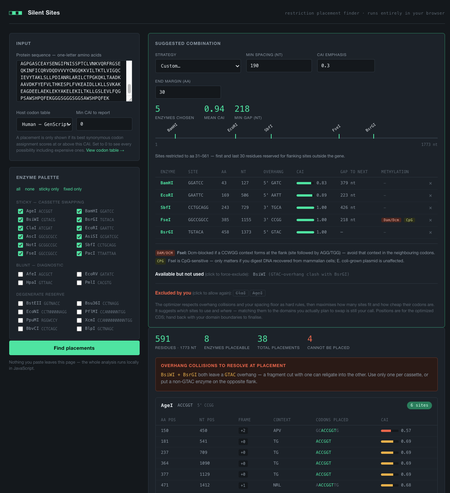

# Silent Sites: find silent restriction sites for a synthetic gene

Paste a protein sequence and get a list of positions where restriction enzyme sites can be
placed **silently**, without changing the amino acids, plus a suggested combination of
well-spaced, unique cutters for future variant cloning. Runs in your browser, nothing is uploaded.

**Try it:** https://ajitr66.github.io/silent-sites/

## What you get

| Output | Meaning |
| --- | --- |
| Suggested combination | Enzymes chosen to respect your minimum spacing and end margin while keeping codon cost low |
| AA / NT position | Where the site goes in the protein and in the coding sequence |
| CAI | Codon adaptation index of the best codon choice that creates the site |
| Overhang collisions | Enzyme pairs that leave the same overhang and could re-ligate into each other |
| Methylation notes | Dam/Dcm and CpG sensitivity for each chosen enzyme |

## Also

- Audited NEB palette (sticky, blunt and degenerate tiers) that you can toggle
- Add your own enzyme from its recognition site and cut positions
- Choose the host codon table and a minimum CAI
- Click an enzyme to force-exclude it from the suggestion

## Workflow

The tool is one step of a larger design process, from donor vector audit through GenScript
codon optimization to validation: see the [full protocol](docs/protocol.md).

## Changelog

- **v1.1** (2026-09-16): add custom enzymes by recognition site and cut positions
- **v1.0** (2026-08-17): first version

## Credits

Created by Ajit Ramamohan ([@Ajitr66](https://github.com/Ajitr66)).
Developed with assistance from Claude (Anthropic).

## License

MIT, see [LICENSE](LICENSE).
